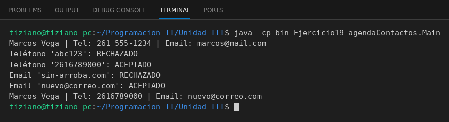

# Contacto

Programación II - Unidad 3 - Ejercicio 19

## Consigna
Modelar la clase aplicando encapsulamiento: atributos privados y métodos públicos que validan antes de modificar el estado. Un contacto con validación de teléfono y correo en sus setters.

## Lógica
- `setEmail` exige el carácter `@`.
- `setTelefono` rechaza letras con una expresión regular.
- `obtenerFicha()` devuelve los datos formateados.
- `Main` prueba valores correctos e incorrectos.

## Ejecución

